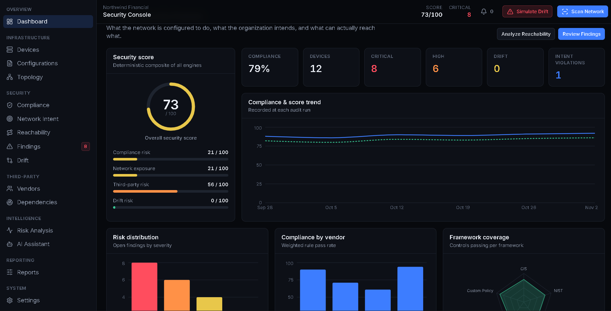
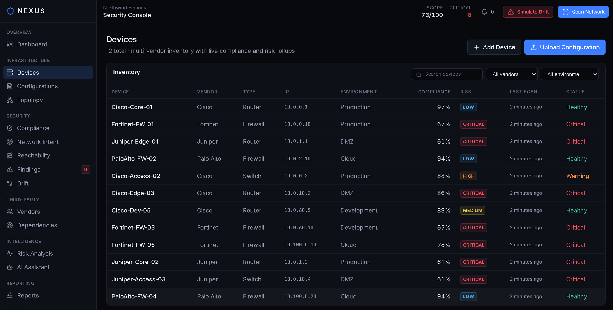
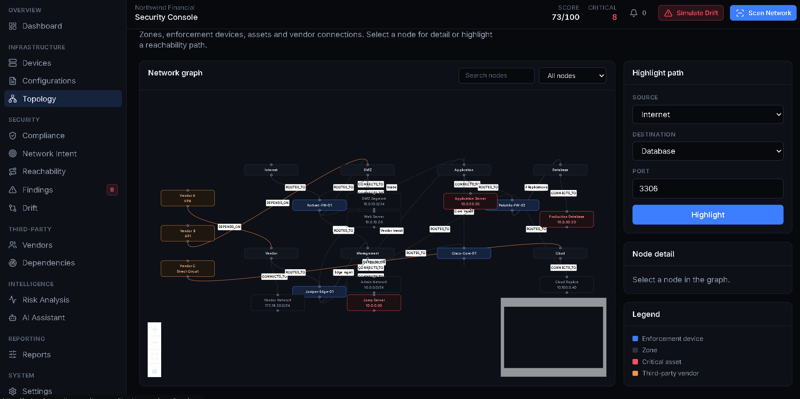
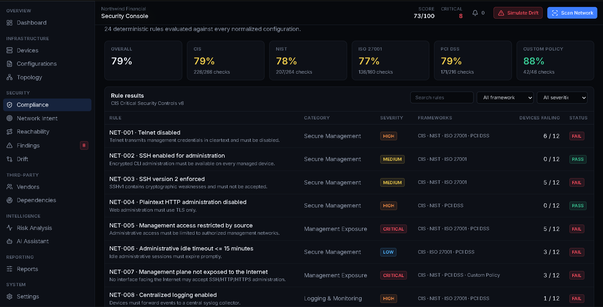
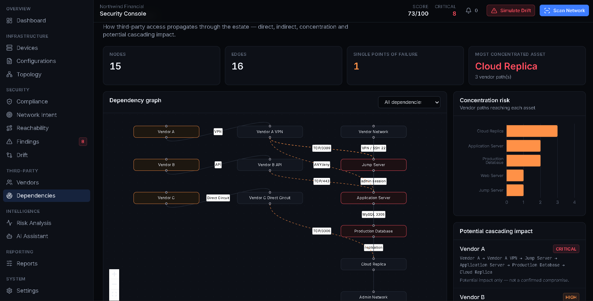

# NEXUS – AI-Driven Multi-Vendor Network Security Compliance Auditor

<p align="center">
  <strong>A unified platform for multi-vendor network configuration analysis, compliance evaluation, and risk assessment.</strong>
</p>

NEXUS is a browser-based network security configuration analysis application. It helps users review supported configurations from **Cisco, Fortinet, Juniper, and Palo Alto** through a common interface. Vendor-specific parsers convert supported configuration text into a normalized representation, which is evaluated by a deterministic rule-based engine.

The application brings compliance results, security findings, modeled network analysis, configuration drift comparison, third-party dependency analysis, and risk indicators together in one dashboard.

> **Project scope:** This repository describes the current academic project implementation. NEXUS analyzes supplied configuration text and application-managed/sample data. It does not connect to physical network devices or perform live network traffic monitoring.

---

## Table of Contents

- [Problem Statement](#problem-statement)
- [Objectives](#objectives)
- [Features](#features)
- [How It Works](#how-it-works)
- [Screenshots](#screenshots)
- [Technology Stack](#technology-stack)
- [Getting Started](#getting-started)
- [Project Structure](#project-structure)
- [Current Limitations](#current-limitations)
- [Future Enhancements](#future-enhancements)
- [Team](#team)
- [Acknowledgements](#acknowledgements)
- [Disclaimer](#disclaimer)

## Problem Statement

Network environments often contain devices from multiple vendors, each with its own configuration syntax and security policies. Manually reviewing these configurations can be time-consuming and makes it difficult to evaluate security controls consistently.

NEXUS addresses this challenge by providing a centralized workflow to parse supported multi-vendor configurations, evaluate predefined security rules, identify potential compliance issues, and present consolidated network security insights.

## Objectives

- Simplify configuration review across supported network vendors.
- Identify security misconfigurations using predefined rules.
- Evaluate configurations against selected security framework mappings.
- Visualize modeled network topology and communication paths.
- Compare configuration snapshots to identify selected changes.
- Present findings, risk indicators, and remediation guidance in one interface.

## Features

### 1. Multi-Vendor Configuration Parsing
- Supports Cisco, Fortinet, Juniper, and Palo Alto configuration formats.
- Uses syntax patterns to identify the likely vendor.
- Extracts supported configuration properties through vendor-specific parsers.
- Converts parsed information into a normalized representation.

### 2. Deterministic Compliance Evaluation
- Evaluates normalized configuration data using **24 predefined rules**.
- Produces `PASS` or `FAIL` outcomes with expected and actual values.
- Associates rules with severity levels and framework mappings.
- Maps implemented checks to CIS, NIST, ISO 27001, PCI DSS, and Custom Policy labels.
- Calculates weighted compliance scores.

### 3. Security Findings
- Presents failed checks and other analysis outcomes as findings.
- Displays affected devices/assets, severity, category, and evidence.
- Provides remediation guidance where available.

### 4. Security Dashboard
- Summarizes security and compliance indicators.
- Visualizes risk distribution, compliance trends, vendor results, and framework coverage.
- Displays findings, drift, and network intent indicators.

### 5. Device Inventory
- Displays the modeled multi-vendor device inventory.
- Shows device vendor, type, IP address, environment, compliance, risk level, and status.

### 6. Network Topology
- Visualizes modeled zones, enforcement devices, assets, vendors, and connections.
- Supports node selection, search, and filtering.
- Highlights modeled paths using source, destination, and port inputs.

### 7. Reachability Analysis
- Builds candidate paths between modeled network zones.
- Evaluates firewall rules in sequence order at guarded hops.
- Identifies modeled allowed or blocked paths.
- Applies an implicit deny when no rule matches.

### 8. Network Intent and Segmentation
- Represents expected communication using source zone, destination zone, protocol, port, and expected action.
- Compares expected behavior with modeled reachability.
- Flags mismatches as network intent violations.

### 9. Configuration Drift Detection
- Compares a baseline snapshot with a later snapshot.
- Detects changes in selected configuration fields and policy-rule properties.
- Classifies detected changes using the project's severity logic.
- Includes a drift simulation for demonstration.

### 10. Third-Party Dependency Analysis
- Visualizes modeled vendor-to-asset relationships.
- Traces potential downstream impact.
- Highlights vendor concentration risk and modeled single points of failure.

### 11. Risk Scoring
- Calculates deterministic risk scores using findings, compliance, exposed flows, sensitive-asset exposure, vendor risk, and drift events.
- Presents overall and component-level risk indicators.

### 12. Local Assistant
- Generates template-based explanations and impact descriptions from application findings.
- Provides remediation suggestions.
- Sanitizes sensitive configuration values before preparing assistant context.
- The current assistant is local and template-based; it does not call an external LLM API.

## How It Works

1. **Configuration input:** The user supplies supported configuration text or uses the sample environment.
2. **Vendor detection:** NEXUS identifies the likely vendor using syntax patterns.
3. **Parsing:** The corresponding vendor-specific parser extracts supported properties.
4. **Normalization:** Parsed properties are converted into a common data representation.
5. **Compliance evaluation:** The deterministic rule engine evaluates the normalized data.
6. **Analysis:** The application generates findings, compliance results, risk indicators, and modeled network analysis.
7. **Visualization:** Results are presented through dashboards, tables, and graph-based views.

## Screenshots

The following screenshots are from the project's supplied application captures. Dashboard values and device/network details shown are sample demonstration data, not production measurements.

### Security Dashboard



### Multi-Vendor Device Inventory



### Network Topology and Path Highlighting



### Compliance Evaluation



### Third-Party Dependency Analysis



## Technology Stack

| Area | Technologies |
|---|---|
| Languages | TypeScript, JavaScript |
| Frontend | React 18, React DOM |
| Build Tool | Vite 5 |
| Styling | Tailwind CSS 3, CSS |
| Routing | React Router DOM 6 |
| Charts | Recharts |
| Graph Visualization | `@xyflow/react` |
| Icons | Lucide React |
| Notifications | Sonner |
| Browser Persistence | Web Storage API (`localStorage`) |
| Deployment | Vercel |

## Getting Started

### Prerequisites

- Node.js (compatible with the Vite project)
- npm
- Git

### 1. Clone the repository

```bash
git clone https://github.com/abhinavkarnata-stack/Network-Security-Compliance-Auditor.git
cd Network-Security-Compliance-Auditor
```

### 2. Install dependencies

```bash
npm install
```

### 3. Start the development server

```bash
npm run dev
```

Open the local URL printed in the terminal to use the application.

### Other available scripts

```bash
npm run build
npm run preview
npm run lint
```

## Project Structure

The main source folders are organized as follows:

```text
NEXUS/
├── public/
├── src/
│   ├── components/
│   │   ├── layout/
│   │   └── ui/
│   ├── data/
│   ├── engine/
│   │   └── parsers/
│   ├── pages/
│   ├── store/
│   ├── types/
│   ├── App.tsx
│   └── index.tsx
├── index.html
├── package.json
├── vite.config.ts
├── tailwind.config.js
└── README.md
```

## Current Limitations

- The current application does not directly connect to physical network devices.
- It does not perform live network scanning, packet capture, or real-time traffic monitoring.
- Parsing is limited to supported configuration syntax and properties implemented for the four vendors.
- Application data is stored in browser `localStorage`; there is no server-side database or backend API in the current build.
- Compliance checks are project-defined rules mapped to framework labels; they do not constitute formal or accredited certification.
- Topology, reachability, segmentation, and dependency outputs are based on modeled relationships and supplied application data.
- The local assistant uses templates rather than a live external large language model.
- Risk scores are based on the project's deterministic calculation and available application data, not live threat intelligence.

## Future Enhancements

The following are proposed directions and are **not part of the current implementation**:

- Backend API and centralized database for shared, multi-user persistence.
- Live configuration collection from network devices or version control.
- Additional vendor parsers and an expanded security rule catalogue.
- Optional LLM-backed assistant with appropriate secret protection.
- Exportable audit and compliance reports.
- Real-time network monitoring and security event integration.


The project was developed collaboratively, with shared participation in planning, development, feature work, testing, integration, and documentation.

## Acknowledgements

The project was developed collaboratively, with shared participation in planning, development, feature work, testing, integration, and documentation.

Development and AI-assisted tools used during the project included ChatGPT, Claude, Magic Patterns, and Vercel.

## Disclaimer

NEXUS is an academic configuration-analysis and demonstration application. Its outputs depend on supplied configuration text and modeled network data. Framework mappings should not be interpreted as official certifications, and modeled reachability or dependency results should not be treated as independent verification of a production network.
